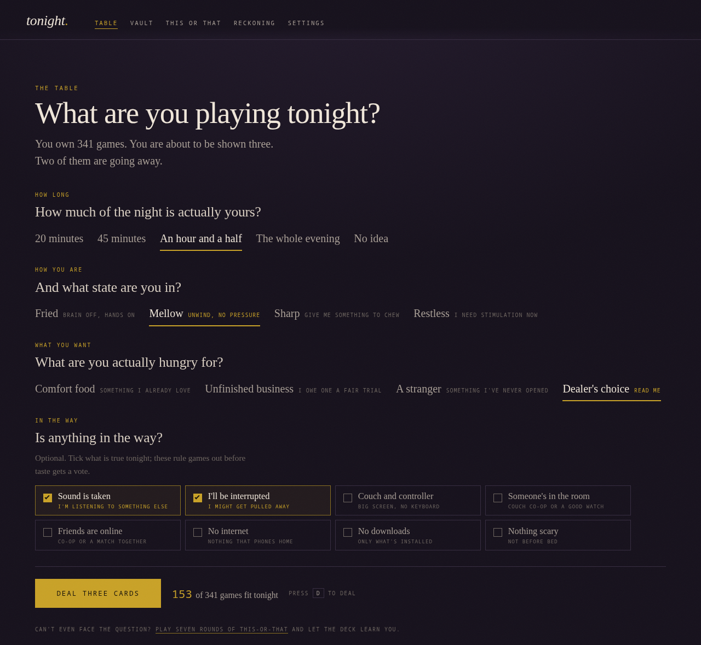
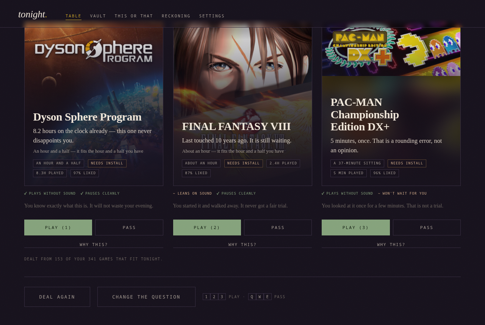
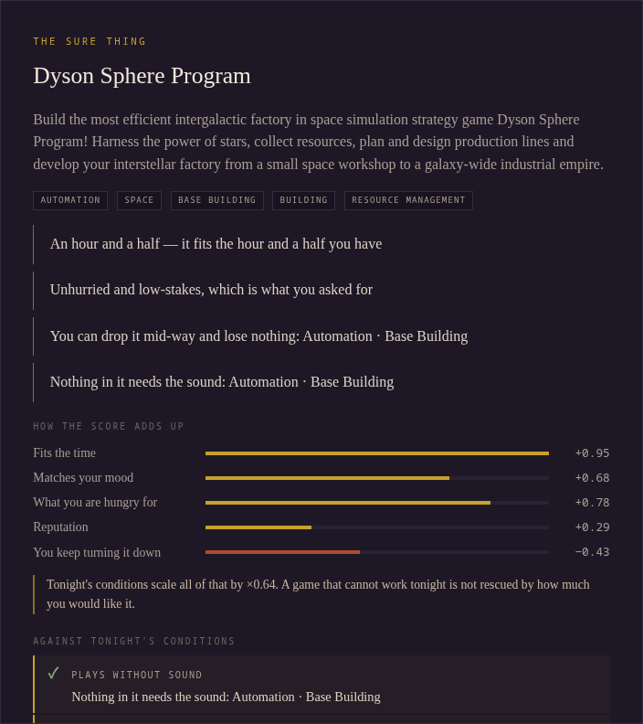

# tonight

**A decision engine for your Steam library.** Three cards, two passes, one game.

You own hundreds of games and you play the same four. The problem was never that
you lack options — it is that an infinite grid of boxart is a decision engine
running in reverse. `tonight` deletes the grid. It asks you three questions, deals
you exactly three games, and takes two of them away.

Self-hosted, single binary, SQLite, no account, no telemetry. It reads your local
Steam client directly, so it works with **no API key and no credentials at all**.

---

## Install

One command. No Rust, no Docker, no terminal expertise. It downloads the right
binary, sets itself to start with your login, and opens the table.

**Linux / macOS**

```sh
curl -fsSL https://github.com/guitaripod/tonight/releases/latest/download/install.sh | sh
```

**Windows** (PowerShell — right-click the Start menu → Terminal)

```powershell
irm https://github.com/guitaripod/tonight/releases/latest/download/install.ps1 | iex
```

That is the whole setup — it finds your Steam install, reads it, and starts
identifying your library in the background. Binaries are attached to every
[release](https://github.com/guitaripod/tonight/releases) too, if you would rather
click a download than pipe a script.

### Advanced

- **From source** — clone, `cargo build --release`, `./target/release/tonight --open`.
- **Docker** — `docker compose up -d`. The container sees only the Steam root it
  mounts; a library on another drive needs its own mount at the same path, or its
  games count as not installed.
- **As a systemd service** — or just run `install.sh` with a user session, which
  sets this up for you. The unit is in `packaging/tonight.service`.

## The table

Four questions, then the hand. Cards land face-down and turn over. You choose a
kind of evening — a sure thing, unfinished business, or a stranger — never a wall
of boxart. The fourth question is the one a library never asks: **is anything in
the way tonight?**

| The deal | The table afterwards |
| --- | --- |
|  |  |

Every recommendation states its reasoning in a sentence you can argue with —
*"You stopped 40 minutes in, 9 months ago. That was never a fair trial."* — and
*Why this?* shows the arithmetic behind it:

<p align="center"></p>

---

## The thesis

Choice paralysis is not an information problem, so more information does not fix
it. Every complaint people have about their backlog is one of seven things, and each
one is a design decision here:

| The complaint | What `tonight` does |
| --- | --- |
| "Too many options, I can't compare them" | Never shows more than three, and the three are deliberately incomparable: a **sure thing**, an **unfinished business**, and a **stranger**. You are choosing a kind of evening, not a game. |
| "I browse for 40 minutes and then watch YouTube" | Passing is limited. Two passes and the last card is the verdict — there is no third pass. Re-dealing is allowed, counted, and told to your face. |
| "I don't know if I have time for it" | Every game gets a **session shape** — how long one sitting actually is — derived from genre, categories and description, then corrected by how long *you* actually play it. A 20-minute slot never offers you a grand strategy game. |
| "I don't know what I'm in the mood for" | Five moods map to five axes (pace, thinking, story, company, calm). The engine matches the game's shape to your state. |
| "I feel guilty about the ones I never played" | **Amnesty.** Retire a game permanently, in one tap, with the hours it removes from your backlog counted for you. A backlog is only a debt if you agree to owe it. |
| "I want to play, but I'm listening to something else" | **Conditions.** Tick *Sound is taken* and games that need their audio are ruled out before taste gets a vote: no horror, no rhythm games, no footstep-driven shooters. What is left plays fine under a podcast. |
| "I bounce off everything and feel bad" | The **first-impression checkpoint**: twelve minutes in, `tonight` asks whether it is working. Bailing is a first-class, logged, guilt-free answer — and it immediately deals you a replacement. |

Every recommendation states its reasoning in a sentence you can argue with:
*"You stopped 40 minutes in, 9 months ago. That was never a fair trial."*

## Tonight's conditions

Taste says what you want. A condition says what is possible. Tick whatever is true
about tonight and the engine checks it before it ranks anything; a live counter
shows how many of your games survive.

| Condition | What it rules out | Where the answer comes from |
| --- | --- | --- |
| **Sound is taken** | Games that lean on their audio: horror, rhythm, stealth, competitive shooters, voiced story games | Store tags, voice-acting flags, *captions available*, *surround sound* |
| **I'll be interrupted** | Games that will not wait: online matches, runs you cannot pause | *Save anytime*, *playable without timed input*, tags, online modes |
| **Couch and controller** | Games that want a keyboard and mouse | *Full controller support*, Steam Deck input data |
| **Someone's in the room** | Solo, twitchy games | Split-screen categories, local-multiplayer tags, how watchable the game is |
| **Friends are online** | Solo games | Online co-op and PvP categories |
| **No internet** | Games that need a connection | Online-only modes, Steam's own "requires internet" flag |
| **No downloads** | Anything not installed | Your Steam library folders |
| **Nothing scary** | Horror and sustained tension | Horror, jump-scare and dark tags |

Every card shows how it meets each condition you ticked (✓ works, ~ leans on it,
✕ fails), and *Why this?* explains it in a sentence. Anything the engine got wrong
you can overrule per game: how much the sound matters, and how long one sitting is.
When you bail out of a game, tonight asks why. "I couldn't hear it" teaches the
engine something very different from "it wasn't good".

## How a hand is calculated

1. **Know the game.** Steam's own client cache holds the community's tags, the
   developer's feature checklist, voice-acting flags and Deck compatibility for
   every game you own. Each is a weighted vote on eleven traits: pace, thinking,
   story, company, calm, **sound, interruptibility, fright, online, controller and
   couch**. Votes are combined with a prior, and every trait keeps its own
   confidence. A game the engine knows little about is never assumed to be safe.
2. **Rule out.** Conditions and the time budget decide who may be dealt at all. If
   too few games survive, the dealer loosens one rung at a time and says so
   (*"Few games meet “Sound is taken” strictly, so I loosened it a little"*). If
   nothing survives, it names the condition that is costing the most.
3. **Score.** Desire (mood, appetite, taste, reputation, momentum) is added up, then
   scaled by how well the game meets tonight's conditions, so a game that cannot work
   tonight is not rescued by how much you would like it. Every term records its own
   arithmetic, shown in *Why this?*.
4. **Deal.** One card per kind of evening, each pushed away from what is already on the
   table, drawn from the best few so that dealing again gives a different hand.
5. **Learn.** Passes, duels, verdicts and bail-out reasons move per-genre, per-tag and
   per-archetype taste weights. Nothing leaves your machine.

## Screens

- **The table** — the questions, then the hand. Cards land face-down and turn over.
- **This or that** — seven forced pairwise choices. Cheap for you, dense for the model; Elo plus per-genre weights.
- **The reckoning** — the honest arithmetic. How many you have never opened, what
  the unopened ones cost, and the year you would finish at your real pace. How many
  of your games work when something is in the way. Then the amnesty flow, which
  offers the least likely candidates three at a time.
- **The vault** — search-only. There is deliberately no browsable wall of boxart
  anywhere in this app; instead there are shelves that are questions
  ("You walked out early", "Ghosts", "Plays under a podcast", "Drop it any time").

## Where the data comes from

| Source | Needs | Gives |
| --- | --- | --- |
| `appcache/appinfo.vdf` | nothing | Name, type, community tags, feature checklist, voice-acting flags, Deck compatibility and review scores of every app your client knows — parsed offline from Steam's own binary cache |
| `userdata/*/config/localconfig.vdf` | nothing | Minutes played and last-played, per game |
| `steamapps/appmanifest_*.acf` | nothing | What is installed, and how big it is |
| `store.steampowered.com/api/appdetails` | nothing | Description, price, developers, release date, achievements |
| `IPlayerService/GetOwnedGames` | a Web API key | Games you own but never installed on this machine |
| `ISteamUserStats/GetPlayerAchievements` | a Web API key | How close you are to finishing something |

The key is optional and only ever leaves your machine to talk to Valve. Artwork is
proxied and cached to disk, so your browser never contacts Valve at all and a
warmed instance works offline.

## Options

```
-b, --bind <ADDR>   Listen address (default 0.0.0.0:7777, env TONIGHT_BIND)
-p, --port <PORT>   Shorthand for --bind 0.0.0.0:<PORT>
-d, --data <DIR>    Data directory (env TONIGHT_DATA_DIR)
    --steam <DIR>   Steam root, e.g. ~/.steam/steam (env TONIGHT_STEAM_ROOT)
    --open          Open a browser once the server is up
```

Everything else lives in Settings: the API key, the checkpoint length, your weekly
hours, and whether the server may start games on its own machine.

### Launching from the sofa

If `tonight` runs on your gaming PC, turn on **"Let this server start games on its
own machine"** and picking a card on your phone launches the game on the PC. It is
off by default, because it runs a command on the host.

Without it, `tonight` hands your browser a `steam://rungameid/<appid>` link, which
works whenever the browser is on the same machine as Steam.

## Keyboard

| Key | Does |
| --- | --- |
| `D` | Deal |
| `1` `2` `3` | Play that card |
| `Q` `W` `E` | Pass that card |
| `/` | Search the vault |
| `X` | End the session |
| `?` | Show this list |

## Your data

`~/.local/share/tonight/tonight.db` — one SQLite file. `Export my data` in Settings
gives you every judgement you have made as JSON, including the games you overruled.
`Forget my taste` wipes what the deck has learned from duels and verdicts. Nothing is
sent anywhere.

## Licence

GPL-3.0-only.
